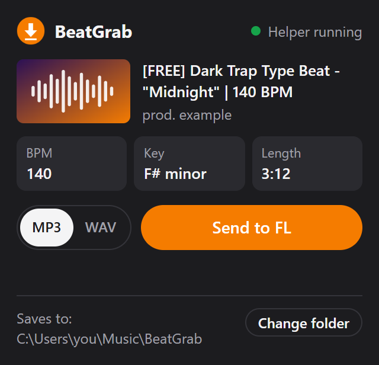

<p align="center">
  
</p>

<h1 align="center">BeatGrab</h1>

<p align="center">One click on a YouTube beat, and it's in your FL Studio Browser as MP3 or WAV.</p>

<p align="center">
  <a href="https://github.com/ladroxd/BeatGrab/archive/refs/heads/main.zip"></a>
</p>

---

BeatGrab is a small Chrome extension for producers who find beats on YouTube. It adds a **Send to FL** button next to the Like button; one click saves the audio into a folder that FL Studio's Browser already watches, so the beat is ready to drag into the Playlist. It also shows the beat's BPM and key when the uploader listed them. Everything runs on your own PC: no account, no website, no upload.

<p align="center">
  
</p>

## Download

**[Download BeatGrab](https://github.com/ladroxd/BeatGrab/archive/refs/heads/main.zip)** for Windows 10 or 11 and unzip it somewhere you'll keep it.

BeatGrab isn't on the Chrome Web Store (it doesn't accept YouTube downloaders), so you load it into Chrome yourself. That takes a minute; see [Getting started](#getting-started).

To update, download it again, replace the folder, and press the reload arrow on the BeatGrab card in `chrome://extensions`. What changed in each version is in the [changelog](CHANGELOG.md).

## Features

### Send to FL

- A **Send to FL** button next to Like on every YouTube watch page
- Or press **Alt+Shift+G**, or use the button in the toolbar window
- The file lands in your BeatGrab folder, which FL Studio's Browser shows once you add it as a search folder
- The folder also opens with the new file selected, ready to drag into the Playlist
- A Windows notification tells you when the beat is saved, or why it failed

### BPM and key

- The toolbar window shows the beat's **BPM** and **key** before you download
- They go in front of the saved filename, so beats sort and read at a glance in FL Studio: `[140 BPM - Am] (FREE) Travis Scott Type Beat.mp3`. Only what's known is added (`[140 BPM]`, `[Am]`), and nothing when neither is
- They're read from what the uploader wrote, in this order: the title, the description, the uploader's own comments (the pinned one first), the BeatStars page linked in the description or a pinned comment, then the tags
- Hover the BPM or key in the toolbar window to see where it was found
- Understands the usual ways producers write them: `140 BPM`, `BPM: 92`, `F#m`, `Key: C minor`, `Bb Major`, `E flat minor`
- Shows "Not listed" when the uploader didn't write them. Nothing is guessed from the audio

### Beat details

- Thumbnail, title, uploader and length in the toolbar window
- A status dot shows whether the helper is running, so you know a click will work

### MP3 or WAV

- Switch between **MP3** and **WAV** in the toolbar window
- The choice is remembered and applies to the in-page button and the shortcut too
- MP3 files carry the title, uploader and cover art as tags
- WAV is there for workflows that need it. It's several times bigger and no better in quality, because YouTube's audio is already compressed

### Your folder

- Saves to `Music\BeatGrab` by default
- **Change folder** opens the normal Windows folder window, and the choice is remembered
- Titles with accents, emoji or non-Latin characters are saved correctly

### Small and private

- The extension only talks to a helper on your own PC (`127.0.0.1`). The helper only contacts YouTube, and BeatStars when the uploader linked a beat there and didn't write the BPM or key on YouTube
- The helper only accepts requests from the extension, so websites can't trigger downloads
- Starts with Chrome and stops when you close Chrome. No window, nothing to launch, and it sits idle until you click
- If the helper ever stops while Chrome is open, BeatGrab starts it again on its own
- One video per click. Playlists are ignored on purpose

## Requirements

- Windows 10 or 11
- Google Chrome (or another Chromium browser that loads unpacked extensions)
- [Python](https://www.python.org/downloads/) 3 (tested on 3.12)
- [yt-dlp](https://github.com/yt-dlp/yt-dlp), [ffmpeg](https://ffmpeg.org) and [Node.js](https://nodejs.org), installed with the three commands below
- FL Studio, or any DAW that can watch a folder

## Getting started

1. [Download BeatGrab](#download) and unzip it.
2. Install the tools it needs. In Command Prompt:

   ```bat
   pip install -U "yt-dlp[default]"
   winget install ffmpeg
   winget install OpenJS.NodeJS.LTS
   ```

3. In Chrome, open `chrome://extensions`, turn on **Developer mode**, click **Load unpacked** and pick the `extension` folder.
4. Double-click `install-beatgrab.bat`, then close Chrome completely and open it again. From now on the helper starts and stops with Chrome.
5. In FL Studio, open **Options > File settings > Browser extra search folders** and add `C:\Users\<you>\Music\BeatGrab`.
6. Open a beat on YouTube and click **Send to FL**.

The [setup guide](docs/SETUP.md) has the full walkthrough, plus tips and troubleshooting.

## How it works

- **The extension** (`extension/`) adds the button and the toolbar window. It can't download anything itself; it sends the video's address to the helper.
- **The helper** (`helper/beatgrab.py`) is a small Python program listening on `127.0.0.1:9835`. It checks that the address is a single YouTube video, then runs [yt-dlp](https://github.com/yt-dlp/yt-dlp) and [ffmpeg](https://ffmpeg.org) to save the audio.
- **Chrome runs the helper.** `install-beatgrab.bat` registers it as the extension's [native messaging host](https://developer.chrome.com/docs/extensions/develop/concepts/native-messaging). The extension connects when Chrome starts, which launches the helper, and Chrome closes that connection when it quits, which stops it.
- **Downloads are jobs.** The helper answers at once with a job number and the extension checks on it every second, so long videos don't time out.
- **BPM and key** come from the video's title, description, the uploader's top comments and tags, matched against common ways of writing tempo and key. When those don't have them, the helper follows a BeatStars link (`bsta.rs` short links included) and reads the BPM and key the producer entered there. It runs alongside the download, then renames the file.

## What BeatGrab stores

Everything stays on your PC.

| Where | Contents |
| --- | --- |
| Your save folder (default `Music\BeatGrab`) | The MP3 and WAV files |
| `%APPDATA%\BeatGrab\config.json` | The save folder you picked |
| `helper\beatgrab-host.bat`, `helper\com.beatgrab.helper.json` | Written by the installer so Chrome can start the helper |
| Registry, `HKCU\Software\Google\Chrome\NativeMessagingHosts\com.beatgrab.helper` (and the same for Edge and Chromium) | Tells the browser where the helper is. Removed by `install-beatgrab.bat --uninstall` |
| Chrome's extension storage | Your MP3 or WAV preference |

## Disclaimer

Downloading from YouTube is against YouTube's Terms of Service. BeatGrab is meant for personal listening and reference. Get a lease or license from the producer before using any beat in a release.

BeatGrab is an independent project. It isn't made, endorsed or supported by Google, YouTube or Image-Line. YouTube is a trademark of Google LLC. FL Studio is a trademark of Image-Line.

## Author

Made by [Ladro](https://github.com/ladroxd).
